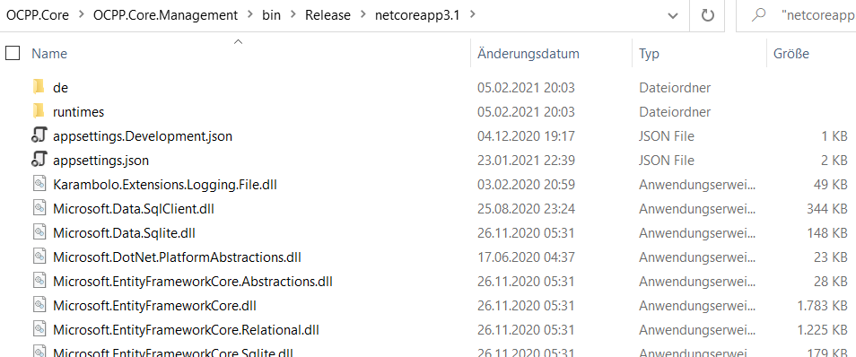
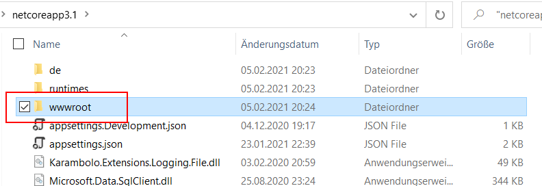

# OCPP.Core Build & Installation

OCPP.Core consists of three projects:
 - OCPP.Core.Server 
 - OCPP.Core.Management
 - OCPP.Core.Database

The "Server" is the web application the charge stations are communicating with.  It understands the OCP-Protocol  and it has a small REST-API for the Management UI.

The "Management" is the Web-UI you can open in the browser. You can manage the charge stations and RFID-tokens there. And of course you can see and download the charge-transaction lists there.

The "Database" is used by both other projects. It contains the necessary Code for reading & writing data from/into the database.

## Database
The project includes templates for SQL-Server and SQLite:

	* SQL-Server (SQL-Express)
	Use the script in the folder 'SQL-Server' to create a new database.
	Configure your account (IIS => AppPool) for reading and writing data.
		
	* SQLite
	The folder 'SQLite' contains an empty ready-to-use database file. Or you use the SQL script in the same folder.

**SQLite:** Server and Management-UI write into the same database file. At startup they switch SQLite to the WAL mode (write-ahead log), so concurrent writes wait for each other instead of failing with "database is locked". In this mode SQLite also uses the files `OCPP.Core.sqlite-wal` and `OCPP.Core.sqlite-shm` next to the database: back up all files (or stop both applications before copying the database file). WAL mode doesn't work on network drives - use a local disk or a Docker volume.

The main Script in both folders always contain the latest version for a full database. For updating an existing SQL-Server database from any previous version there is the update script `SQL-Server/Update_OCPP.Core.sql` (see below).

By default both applications update the database schema automatically at startup (`"AutoMigrateDB": true`). On SQL-Server the database login of the applications usually has no rights to change the schema. Then set `"AutoMigrateDB": false` in both applications and run `SQL-Server/Update_OCPP.Core.sql` with an administrative login (SSMS or `sqlcmd`). It updates a database of any previous version (since V1.0), applies only the missing changes and can be run repeatedly. A new database created with `Create_OCPP.Core.sql` is already up to date. If the database schema is older than the application, both applications log a warning at startup and the Management-UI shows a warning to administrators. Server and Management-UI may start at the same time (e.g. in Docker): the migration is protected by a database lock, the second application waits.

## Webserver
The OCPP-Server and the Web-UI are independent webs/servers and both need database connection information. The Web-UI needs the the URL to the OCPP server for status information and some actions.

**OCPP.Core.Server**
Edit the appsettings.json file and configure the 'SQLite' *or* 'SqlServer' entry:
```
"ConnectionStrings": {
	//"SQLite": "Filename=.\\..\\SQLite\\OCPP.Core.sqlite;"
	"SqlServer": "Server=.;Database=OCPP.Core;Trusted_Connection=True;"
	},
```
If you configure a dump directory, the server writes all OCPP requests and responses there as files (for debugging - they contain tokens and possibly passwords, so it's off by default). Environment variables are expanded (e.g. `%TEMP%\\OCPP`) and the directory is created if necessary. Dump files older than `MessageDumpRetentionDays` are deleted once a day (default 7 days, 0 = keep forever; only files with the name of a dump are deleted). You can also log basic message information in the database.
```
"MessageDumpDir": "c:\\temp\\OCPP",
"MessageDumpRetentionDays": 7,
"DbMessageLog": 2,  //0=None, 1=Info, 2=Verbose (all)
```
The server deletes entries in the database message log (table MessageLog) older than `MessageLogRetentionDays` once a day (default 90 days, 0 = keep forever).
```
"MessageLogRetentionDays": 90,
```
Independent of the message log the server always records business events of the charge points in the EventLog (table EventLog): connections and failed logins, boot notifications (firmware changes), status changes of the connectors, accepted and rejected tokens, start and stop of charging, special cases (e.g. a decreased meter value) and the commands sent to the charge point (with result and user). Administrators can view them in the Management-UI on the detail page of a charge point ("Events"). Events older than `EventLogRetentionDays` are deleted once a day (default 365 days, 0 = keep forever).
```
"EventLogRetentionDays": 365,
```
**OCPP.Core.Management**
See above for the database connection. 
With an empty database the Management-UI shows a setup page to register the first admin user.
If you have existing user definitions in your configuration, these users are migrated into the database.

The Management-UI needs the URL to the OCPP server for internal communication.  To secure this API you can configure API keys (=identical passwords) on both sides:
```
"ServerApiUrl": "http://localhost:8081/API",
"ApiKey": "....",
```

## Security
The OCPP server and its REST-API run on the same port. The API can unlock connectors, start/stop transactions and change charger configurations. Therefore:

- **API key:** Configure a long random `ApiKey` (identical in server and Management-UI). Without an API key the server only accepts API requests from the local computer (e.g. the Management-UI on the same machine or in the same Docker container). Requests from the network or via a reverse proxy (`X-Forwarded-For`/`Forwarded` header) are rejected. Only if you really need the old behavior (API open for everyone without a key) you can set `"AllowUnauthenticatedApi": true` in the server configuration - this is NOT recommended.
- **Chargepoint authentication:** Configure username/password (basic authentication) or a client certificate thumbprint for every chargepoint in the Management-UI. With `"RequireChargePointAuthentication": true` the server rejects all chargepoints without authentication data. The server logs a warning at startup if chargepoints without authentication exist.
- **Chargepoint passwords** are stored as hash (like the Management-UI users) and are not shown again after saving. Leave the password field empty to keep the stored password; the dice button generates a random password (copy it into the chargepoint configuration before saving). Existing plaintext passwords are converted automatically at the next successful login of the chargepoint. This requires the database migration `ChargePointPasswordHash` (SQL-Server: `Update_OCPP.Core.sql`) - until then passwords stay in plaintext. Server and Management-UI must be updated together.
- **Encryption:** By default the server uses unencrypted connections (ws:// and http://). Basic authentication then transmits passwords in clear text. In production use TLS (wss:// and https://), e.g. via a reverse proxy, or at least a trusted network/VPN.

```
"ApiKey": "....",
"AllowUnauthenticatedApi": false,
"RequireChargePointAuthentication": false,
```

### Management-UI login
- **Lockout:** After `LoginMaxFailedAttempts` failed logins (default 5) the login is locked for `LoginLockoutMinutes` (default 5). The lockout is temporary and ends automatically; an administrator can also unlock an account immediately in the user administration. Unknown user names behave exactly the same (same messages, same lockout, same response time), so user names can't be found out systematically. `"LoginMaxFailedAttempts": 0` deactivates the lockout.
- **Passwords** need at least 8 characters (existing passwords remain valid).

```
"LoginMaxFailedAttempts": 5,
"LoginLockoutMinutes": 5,
```

## Connections
After a network failure the server may still consider the old connection of a chargepoint as open. Two settings handle this:

- **ReplaceExistingConnection** (default `true`): a new connection of a chargepoint replaces its existing connection. The old connection is aborted and pending server commands to it end immediately. With `false` the new connection is refused (HTTP 409) as long as the old one seems to be open. If two devices are accidentally configured with the same chargepoint ID, they replace each other - see the warnings in the log.
- **WebSocketPingInterval** / **WebSocketPingTimeout** (default `60` / `60` seconds): the server sends a WebSocket ping in this interval and aborts the connection if no pong arrives within the timeout. Dead connections are detected after about 2 minutes. `0` deactivates the ping (interval) or the check of the pong (timeout).
- **RequestTimeout** (default `60` seconds): how long the server waits for the answer of a chargepoint to a command (e.g. reset, unlock, remote start). The server sends only one command at a time to a chargepoint; a second command waits until the first one is answered or timed out (see `Server-API.md`). Keep the timeout of the Management-UI calls (70 seconds) in mind when you increase it.
- **RemoteStartIdTokenType** (default `ISO14443`, OCPP 2.x): type of the token in a remote start ("start charging" in the Management-UI). The charge tags are normally the IDs of RFID cards (`ISO14443`), so the charge point recognizes the card when it's presented to stop charging. Change it e.g. to `ISO15693` for such cards. With `Central` many charge points don't accept the card as the same token for stopping.

```
"ReplaceExistingConnection": true,
"WebSocketPingInterval": 60,
"WebSocketPingTimeout": 60,
"RequestTimeout": 60,
"RemoteStartIdTokenType": "ISO14443",
```


## Quick run with published release
Download a precompiled [release](https://github.com/dallmann-consulting/OCPP.Core/releases).
They are compiled 'portable' and run on different platforms.

For a quick start use the included SQLite database (folder "SQLite"). The database connection must be activated in the configuration files first.

### Windows
* Download and install the .NET 10 runtime.
* Extract the ZIP file somewhere. 
* Open the file "appsettings.json" in both projects (OCPP.Core.Server and OCPP.Core.Management): activate the "SQLite" connection string (remove the `//`). If the "SqlServer" entry is active, deactivate it (add `//`) - only one connection string may be set.
* Optional: to dump all OCPP messages for debugging, open the file "appsettings.json" in the OCPP.Server and configure "MessageDumpDir" (empty = off).
* Start the "OCPP.Core.Server.exe" and "OCPP.Core.Management.exe". 
* Open "http://localhost:8082" in a browser. With the empty database the Management-UI shows the setup page for the first admin user.

### Linux
For a permanent installation (systemd services, reverse proxy with TLS, backup) see the [Raspberry Pi installation guide](Raspberry-Pi-Installation.md). It works the same way on most Linux distributions.

* Install the .NET 10 runtime for your Linux distribution and version. Instructions [here](https://docs.microsoft.com/en-us/dotnet/core/install/linux).
* Extract the ZIP file somewhere. 
* Open the file "appsettings.json" in both projects (OCPP.Core.Server and OCPP.Core.Management)
	* activate the "SQLite" connection string with a unix path. If the "SqlServer" entry is active, deactivate it (only one connection string may be set):
	```
	"ConnectionStrings": {
	  "SQLite": "Filename=./../SQLite/OCPP.Core.sqlite;"
	  //"SqlServer": "..."
	},
	```
	* Only OCPP.Server, optional: configure "MessageDumpDir" to dump all OCPP messages for debugging (empty = off).
* The user running both applications needs write permissions for the folder "SQLite" (not only for the database file): in WAL mode SQLite creates the files "OCPP.Core.sqlite-wal" and "OCPP.Core.sqlite-shm" there. If you extracted the ZIP file with this user, nothing needs to be done. Don't give write permissions to everyone.
* The path to the database is relative to the current directory. Therefore start each project from its own folder in a separate console:
	```
	cd OCPP.Core.Server
	dotnet OCPP.Core.Server.dll
	```

	```
	cd OCPP.Core.Management
	dotnet OCPP.Core.Management.dll
	```
* Open "http://localhost:8082" in a browser. With the empty database the Management-UI shows the setup page for the first admin user.

### Docker
Both the OCPP server and the Management UI run in a **single container**. A `compose.yaml` is provided that bind-mounts the `./SQLite` folder into the container so the database file is directly accessible on the host.

A ocpp-core.service template is provided for systemd startup of the docker compose container.
This requires a user "ocpp" being setup, and is assuming you have a working directory of
/usr/local/bin/ocpp.core (with the `compose.yaml`).  Adjust as appropriate.

To use pre-built docker container:
	```
	docker pull ghcr.io/dallmann-consulting/ocpp.core:latest
	```
or
	```
	docker pull udallmann/ocpp.core
	```

You should change the API-key via environment variables on your docker host.


## Build
### Build with Visual Studio
If you use VS you can simply open and the compile the solution. Visual Studio will create the correct file structure in the output directory. It should look something like this:



For deployments you should "publish" each project. Then visual studio will automatically add all necessary files (like "wwwroot" - see below) to the output.

### Build with SDK
Make sure that the [.NET 10](https://dotnet.microsoft.com/en-us/download/dotnet/10.0) is installed.

Open a command shell (cmd) and navigate to the folder where the "OCPP.Core.sln" file is. Then enter the following command to start a debug build:

```dotnet build OCPP.Core.sln``` or
```dotnet publish OCPP.Core.sln```

You will hopefully see that all three projects were compiled without errors. You should then have the same output like the VS-Build (see screenshot above).

### Build with Docker
You can build the single container image using docker compose on the root directory of the repository: ```docker compose build```

Alternatively, build the image directly:

```
docker build -t ocpp.core .
```

# Running

**Run with Kestrel (simple Web-Server)**

The compiler output for the two web projects (Server and Management) contain equally named executables:

```OCPP.Core.Server.exe``` and ```OCPP.Core.Management.exe```

You can simply start (double click) these executables. This will start the applications with the simple [Kestrel Web-Server](https://www.tektutorialshub.com/asp-net-core/asp-net-core-kestrel-web-server/).
You will see a command shell where the active URLs are shown and all logging output.

The appsettings.json files contain the following URL settings for the Kestrel server:

 - OCPP.Server without SSL: "http://0.0.0.0:8081" (all network interfaces) => "ws://<host>:8081/OCPP/<chargepoint-ID>"
 - OCPP.Server with SSL: "https://localhost:8091" (only local computer) => "wss://localhost:8091/OCPP/<chargepoint-ID>"
 - OCPP.Management without SSL: "http://0.0.0.0:8082" (all network interfaces)
 - OCPP.Management with SSL: "https://localhost:8092" (only local computer)
 
 Both projects contain a self-signed certificate (.pfx file) for testing purposes. For production use your own certificate or a reverse proxy with TLS. Behind a reverse proxy on the same machine change "0.0.0.0" to "127.0.0.1", so the applications are only reachable through the proxy.

***Attention:***

The Management Web-UI contains a few static files in a folder "wwwroot" in the project. Only the "publish" actions will copy these files. Make sure that this folder was copied to the output:



Most components (bootstrap, fontawesome ...) are loaded externally from the internet. So you won't notice any errors. But with the static files missing, you cannot open chargepoints or RFID-Tokens from the table views.

**Run in IIS**

To run an ASP.NET-Core application in IIS you need to install the .NET-Core Hosting Bundle. This is described here:
https://dotnetcoretutorials.com/2019/12/23/hosting-an-asp-net-core-web-application-in-iis/

Then you can create a website or app-folder in IIS and point to the compiler output folder. If you're using SQL-Server and want integrated security you might also need to configure the app pool.

## Run with Docker
Run ```docker compose up -d``` to start the container. Both services are available immediately (default ports from `compose.yaml`):

 - OCPP WebSocket: `ws://<host>:47532/OCPP/<chargepoint-ID>`
 - Management UI: `http://<host>:47533`

The SQLite database is stored in the `./SQLite` folder next to `compose.yaml` and is directly accessible on the host.
To use SQL Server instead, set `ConnectionStrings__SqlServer` in the environment section of `compose.yaml` and remove `ConnectionStrings__SQLite`.